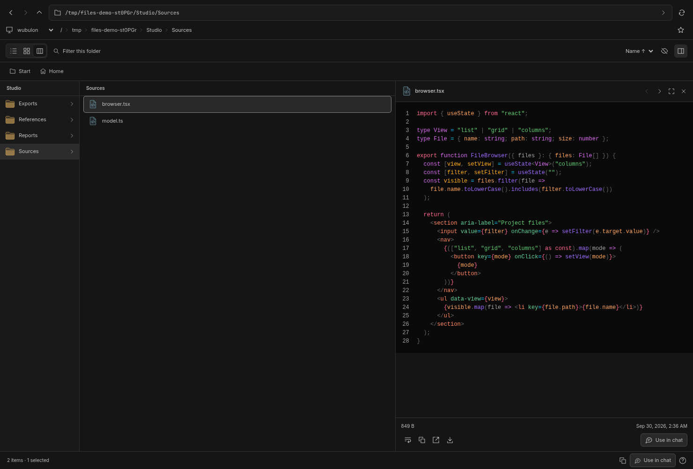
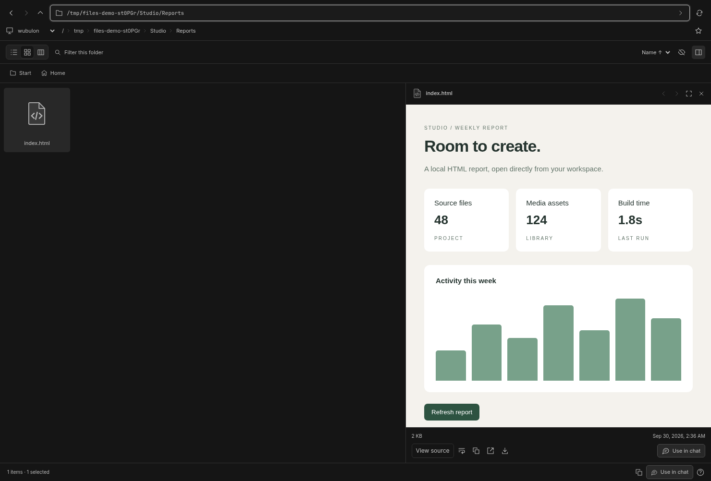

# Files for BB

A compact, path-first file browser and picker. Open **Files** from the sidebar, or open a thread's right panel, choose **New tab → Files**. The thread panel starts in that thread's working directory; the standalone page starts at the project's default source when BB supplies project context, otherwise the server machine's home directory.

- Editable absolute, relative, `~`, and `file://` paths, breadcrumbs, back/forward, and parent navigation.
- List, thumbnail grid, and two-column directory navigation. Large lists render only the visible rows.
- Source preview with BB's syntax highlighting, image fit/actual size, video and audio playback, and next/previous file browsing.
- Folder filtering, hidden files, name/modified/size sorting, persistent bookmarks and view preference.
- Multi-select with Ctrl/Cmd-click, Shift-click, or Ctrl/Cmd-A. Copy paths or **Use in chat** to insert quoted paths into the draft. This does not send a message or upload attachments.
- An explicit machine selector for local and remote BB hosts.

## Install

Requires **BB 0.44.0 or later**. In BB's plugin installer, use:

```text
git:https://github.com/ShamanicArts/bb-plugin-files.git@^0.3.0
```

Or install with the CLI:

```sh
bb plugin install 'git:https://github.com/ShamanicArts/bb-plugin-files.git@^0.3.0' --yes
```

Install `ffmpeg` and `ffprobe` on each machine whose videos you want to preview. Other file browsing and previews work without them. Linux is tested; macOS and Windows are not yet verified.



## Opening files in BB

Files registers BB's supported file-opener hook for HTML, source/text, images, video and audio. With no extension preference, BB chooses the first matching registered opener. **Settings → File openers** lets you explicitly choose **Files** for each extension, including `.html`, `.htm`, `.webm` and `.mp4`. Existing choices are respected; installing the plugin does not overwrite your preferences. These choices belong to each BB client, so set them separately on desktop and remote browser clients.

HTML opens as an interactive document with a **View source** toggle. Relative assets resolve from the file's directory on its machine. Scripts run in an opaque-origin sandbox and cannot access BB's DOM or cookies. Native embedded media, child frames, objects and popups are disabled. Module scripts/fetches that require same-origin access, absolute filesystem assets, parent-directory assets, and apps requiring a backend may not work; serve those apps normally. Files refuses to render truncated HTML above 2 MiB. Line-specific HTML links open source instead.

Files claims only known previewable extensions. Extensionless files can be browsed as text inside Files, while unsupported file links such as PDF and archives retain BB's existing handling.



## Keyboard

| Shortcut | Action |
| --- | --- |
| Ctrl/Cmd L | Focus and select the path |
| Ctrl/Cmd F | Filter the current folder |
| Alt Left / Right | Back / forward |
| Alt Up or Backspace | Parent folder |
| Arrow keys, Home, End | Select files |
| Enter | Open folder or expand file preview |
| Space | Expand/collapse quick look |
| Escape | Collapse quick look, clear filter, or close preview |
| Ctrl/Cmd Enter | Insert selected paths into chat |
| Ctrl/Cmd C | Copy selected paths |
| Ctrl/Cmd . | Show hidden files |
| Ctrl/Cmd 1 / 2 / 3 | List / grid / columns |
| F5 | Refresh directory |
| ? | Shortcut reference |

Shortcuts apply while focus is inside Files. Text and native media controls retain their own editing/playback keys.

## Media architecture

Video defaults to **Compatibility playback**. FFmpeg on the file's machine decodes in a separate subprocess; the panel draws JPEG frames on a canvas and schedules raw stereo PCM through Web Audio. It never creates an HTML video element in this mode. This bypasses the native video surface associated with the reported Arch BB desktop flicker and input freeze. It is a plugin workaround, not a fix to BB or the graphics driver.

Compatibility previews are capped at 1280×720 and 24 fps, with stereo 48 kHz sound. The actual displayed frame rate depends on host speed and network latency. `ffmpeg` and `ffprobe` must be available on each file host's PATH. Missing tools produce an actionable error; Files never silently falls back to native video. Play/pause, seeking, volume, expanded preview and downloads remain available. **Use native player** explicitly opts into the original browser player, which can still trigger the reported desktop issue.

Playback retains a host worker only while a session exists. Pause, close, switching files and seeking stop the old decoder and release audio contexts/bitmaps. Hidden documents pause playback. Abandoned sessions expire after ten seconds without polling; at most four decoders and four preparation jobs run on a host. JPEG frames, PCM queues and RPC replies are bounded. Slow clients drop video frames; audio backlog fails with a retry message instead of growing without limit. Preparation has a 15-second timeout. Plugin host disposal stops children.

Native audio, opt-in native video and downloads use a temporary media lease with `HEAD`, HTTP 206, open/suffix byte ranges, 416 and `If-Range`. Each host read is at most 256 KiB and checked against the file identity. Streams have backpressure, cancellation, bounded leases and an eight-response concurrency cap. BB's built-in `/file-previews` loader is not used for these streams: the tested core route ignored Range and buffered the whole file.

Images use BB's confined preview URLs. Grid thumbnails load lazily and skip originals larger than 10 MiB. Text previews are read-only and capped at 512 KiB; HTML has a 2 MiB limit. Listings cap at 20,000 entries and disclose truncation. No files are edited, renamed, or deleted by the plugin. Column mode shows the parent directory and current directory, with preview beside or below them depending on panel width.

## Development

```sh
npm install
bb plugin types .
npm run typecheck
npm test
npm run build
bb plugin install . --yes
```

The frontend uses React/TypeScript and the installed BB theme and source renderer. The host entry is portable Node, distributed by BB to connected machines. There is no Rust/Wasm build dependency: filesystem I/O and media decoding are handled by BB host workers and existing FFmpeg software decoders.

`npm run test:ui` runs headless Chromium against the running BB server (`BB_SERVER_URL`, with a local fallback). The live UI suite uses the local fixture directory under `artifacts/fixtures/Studio`, prepared by `npm run fixtures`; it requires Files installed and loaded. `CHROMIUM_PATH` overrides `/usr/bin/chromium`. It does not launch visible windows or send chat messages.

## RPC

Inspect contracts with `bb plugin rpc inspect files`. Methods: `resolveFile`, `context`, `list`, `text`, `html`, `preview` (images), `media` (bounded file stream), and `videoInfo`, `videoPoster`, `videoStart`, `videoPoll`, `videoStop` (compatibility playback). For example, save `{"hostId":"<machine-id>","path":"~"}` to an input file and run:

```sh
bb plugin rpc call files list --input-file input.json --json
```

`context` takes `{threadId, projectId}` (both nullable). `list` takes `{hostId,path,base?}`. `text`, `preview` and `media` take `{hostId,path}`. Media URLs are temporary and remain under BB's normal plugin HTTP authentication. The plugin owns no external service, server port, or credentials.

Compatibility RPC: `videoInfo` takes `{hostId,path}`; `videoPoster` and `videoStart` add a nonnegative `time` in seconds. Start returns an opaque session `id`. `videoPoll` and `videoStop` take `{hostId,id}`. Poll returns a latest JPEG, timestamp, interleaved float32 little-endian stereo PCM, audio timestamp and EOF flag. Poll at roughly 20 Hz while playing, stop on close, and expect idle expiry. These RPCs use BB's existing host transport and authentication; no extra port is exposed.

Tests require FFmpeg/ffprobe. To exercise a specific video in the live compatibility test, set `FILES_VIDEO_TEST_PATH=/absolute/path/to/video.webm` and run `npx playwright test -g 'compatibility video'`.


## Validation and releases

See [verification and known limits](VERIFICATION.md) and [release notes](CHANGELOG.md). GitHub Actions checks types and backend tests on Linux with FFmpeg. Live BB UI, host transport, build and package checks are run separately before release; CI does not pretend to run an installed BB desktop.

```sh
npm ci
npm run typecheck
npm test
npm run fixtures
npm run build
bb plugin reload files
npm run test:ui
npm run check:package
```

Set `BB_SERVER_URL` for live tests, and `BB_THREAD_ID` to include BB's file-opener integration test. `CHROMIUM_PATH` selects the browser. `FILES_LOCAL_HOST_ID` selects the local fixture machine for `node tests/transport.mjs`; `FILES_REMOTE_HOST_ID` selects an explicitly configured connected Unix host for `node tests/remote-media.mjs`. The remote test writes its own temporary MP4 and removes it afterward. No test sends a chat message.

The GitHub release includes a prebuilt package and SHA-256 checksum. Git installs build source through BB. No npm publication is required. The runtime needs no external credentials or additional server port. Licensed under MIT.
